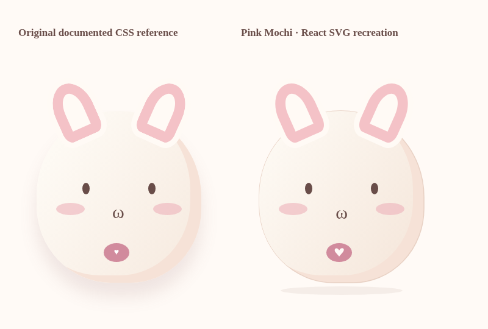

# Pink Mochi — visual verification

Verified on 14 October 2026 against the mandatory [PINK_MOCHI_DESIGN.md](../PINK_MOCHI_DESIGN.md). The reference document is unchanged.

## Mascot comparison

The left bunny renders the original documented HTML/CSS geometry. The right bunny renders the final React SVG at the same scale. Both use the original 270 × 282 body proportions, rotated long cream/pink ears, tiny brown eyes, rosy cheeks, omega mouth, and pink heart badge. The SVG uses a thin peach outline and a soft ground shadow. The hero adds the original peach halo and floating decorations. All mascot appearances use this same bunny component, including accessories and emotional states.

## Production screenshots

These images were captured from the final production build in Chromium with reduced motion enabled, after loading the bundled fonts. No source styles were changed for capture.

| Screenshot | Capture |
| --- | --- |
| [Home desktop](home-desktop.png) | 1440 × 1000 viewport |
| [Room desktop](room-desktop.png) | 1440 × 1000 viewport |
| [Home mobile](home-mobile.png) | Complete hero at 390 px width |
| [Room mobile](room-mobile.png) | Complete care panel at 390 px width |
| [Room mobile viewport](room-mobile-viewport.png) | Actual 390 × 844 touch viewport |
| [Closet mobile](closet-mobile.png) | Complete closet at 390 px width |
| [Hidden ending mobile](hidden-ending-mobile.png) | 390 × 844 viewport; letter scrolls within the dialog |

The complete mobile section captures use a taller capture viewport so the sticky navigation does not cover the bunny. The separate phone viewport capture preserves the regular 844 px screen height. Visual review checked the bunny silhouette, ears, cheeks, mouth, heart badge, accessory previews, cohesive palette, readable controls, and scrollable ending.

## Validation

`npm test` passed all **45 browser tests**, including the existing content and navigation, every care interaction, sleep/wake, emotional reactions, returning greeting, accessory unlock/equip/persistence, both endings, mini game scores and pause/resume, keyboard tabs, accessibility contrast/focus, unavailable or corrupt storage, offline reload and care, and layouts at **320, 390, 768, and 1440 px**. Root and GitHub Pages production builds passed. These are Chromium touchscreen/viewport checks, not a physical iPhone/Safari test.

The production ZIP is generated from `dist/`. GitHub Pages receives the corresponding prefix-aware `dist-pages/` build, preserving the existing `/surprise-for-maybe/` URL.

## MAYBEVERSE 2.0 production gallery

The newer screenshots below were captured from the upgraded production build. Pink Mochi retains the documented silhouette, proportions, long cream/pink ears, brown eyes, rosy cheeks, omega mouth, and heart badge. The hero and mandatory mascot reference remain recognizable. The new neighborhood uses the same typefaces and pastel palette.

| View | Screenshot |
| --- | --- |
| Original bunny on the upgraded home | [Desktop](v2/home-desktop.png), [complete mobile hero](v2/home-mobile.png) |
| Welcome portal | [Desktop](v2/portal-desktop.png), [390 × 844](v2/portal-mobile.png), [access granted](v2/portal-granted-mobile.png) |
| Interactive neighborhood | [Desktop](v2/explore-desktop.png), [complete mobile section](v2/explore-mobile.png), [390 × 844 viewport](v2/explore-mobile-viewport.png) |
| Expanded bedroom | [Complete mobile room](v2/room-mobile.png) |
| Fortune, hugs, bottle | [Cookie](v2/fortune-mobile.png), [hug machine](v2/hug-mobile.png), [bottle](v2/bottle-mobile.png) |
| Garden | [Complete panel](v2/garden-mobile.png), [390 × 844 viewport](v2/garden-mobile-viewport.png) |
| Free capsule gifts | [Capsule machine and actual reward](v2/capsule-mobile.png) |
| Make Mochi Happy | [A real game round](v2/happy-game-mobile.png) |
| MAYBE constellation | [Complete panel](v2/sky-mobile.png), [390 × 844 viewport](v2/sky-mobile-viewport.png) |
| Sticker album | [All 24 sticker slots and earned collection](v2/album-mobile.png) |
| Comfort controls | [Settings](v2/settings-mobile.png) |
| Animated keyboard/hover hint | [Comfort tooltip](v2/tooltip-desktop.png) |
| Seven-star chapter | [Complete letter](v2/secret-chapter-mobile.png), [390 × 844 viewport](v2/secret-chapter-mobile-viewport.png) |

Full mobile sections are captured at 390 px width with a taller capture viewport. Separate 844 px images show the actual touchscreen-sized screen and scrollable dialogs. No source styles were altered for capture. The gallery’s seven-star letter was unlocked through the real cookie, hug, garden, capsule, happy game, constellation, and bottle interactions. Capture finished without runtime or console errors.

The final full suite passed **83/83 scenarios** using `npx playwright test --workers=2`, including all previous functionality and the new experiences. It additionally checks mobile overflow, touch input, persisted settings, nonrepeating messages, all six gift categories, collectible ownership, growth without penalties, keyboard/focus behavior, accessibility, and offline use of the lazy-loaded experience chunk. Root and GitHub Pages production builds passed. Chromium touch emulation is used; physical iPhone/Safari testing is outside this verification.

After the final envelope and mobile hunt-panel spacing refinements, both production builds were regenerated and four affected checks passed again: both GitHub Pages checks, the full seven-star earning/reading/reopening flow, and phone touch controls with the hunt panel verified above the bottom navigation.

The final animated comfort tooltip was checked with hover and accessibility scanning; that focused home check passed after regenerating both builds. The downloadable ZIP was validated against every file in the final root production build.
